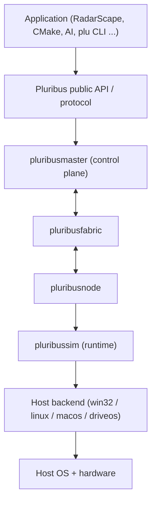
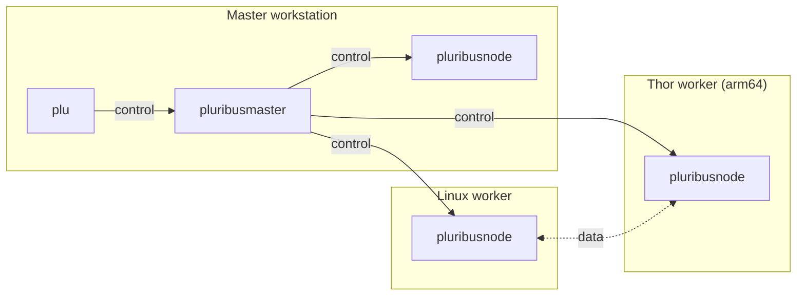

# 1. Overview

## 1.1 Vision

Pluribus is a portable distributed execution environment that combines heterogeneous computers
(Windows, Linux, macOS, NVIDIA DRIVE AGX Thor, later others) into one logical machine.

Applications state **what** they want to run and with **whom** they want to communicate.
Pluribus decides **where** it runs, the host runtime decides **how** the host executes it, and the
fabric decides **how** endpoints talk.

> A Pluribus application identifies what it wants to execute and communicate with, never where that
> work physically lives.

Decision (Q-45): Pluribus is a uniform distributed execution environment, **not a Linux
simulator**. Vertically: Application → Pluribus Environment / ABI → Pluribus Runtime → Host
backend → Windows, Linux, macOS or DRIVE OS. Horizontally, the master coordinates nodes over the
fabric, and each node hosts a runtime. Executions normally neither know nor care where they run.
The application decides **what**, Pluribus **where**, the runtime **how on this host**, and the
fabric **how endpoints communicate**.

## 1.2 Goals

- G1: Submit a compatible native executable as an *Execution* and have it run on a suitable node (Q-4).
- G2: Hide host OS differences behind one runtime contract (`pluribussim`).
- G3: Location-transparent communication between long-running executions via logical *services*.
- G4: Heterogeneous CPU architectures (x86_64, arm64) through multi-architecture packages, no emulation.
- G5: Content-addressed artifacts with automatic caching across executions.
- G6: Domain-agnostic platform: RadarScape, CMake, AI, tests are *clients*, not part of the platform.

## 1.3 Non-goals (V1)

See [08-roadmap.md](08-roadmap.md#non-goals). Highlights: no Linux syscall emulation, no distributed
shared memory, no distributed POSIX filesystem, no master clustering, no security-grade sandbox,
no CPU emulation.

## 1.4 Glossary

| Term | Meaning |
|------|---------|
| Execution | One run of an executable with given spec; the only scheduling primitive |
| ExecutionSpec | Immutable request describing an execution |
| ExecutionHandle | Client-side reference for observing/controlling an execution |
| Node | One physical/virtual machine running `pluribusnode` |
| Master | The single authoritative control plane of one Pluribus machine |
| Pluribus machine | One master + N nodes forming one logical machine |
| Service | A logical, named endpoint exported by an execution |
| Artifact | Immutable, content-addressed blob (SHA-256) |
| Package (`.plp`) | Bundle of manifest, per-architecture executables and resources |
| Capability | Named, qualitative node feature (e.g. `gpu.cuda`) |
| Resource | Quantitative node quantity (CPU, RAM) |
| Sandbox | Per-execution isolated working area (operational, not security-grade in V1) |
| Control plane / data plane | Small control messages vs. potentially large streams |

## 1.5 Layering

## 1.6 Component overview

## 1.7 Architectural principles

1. **Execution is the primitive.** No BuildJob/TestJob/RadarJob types in the core.
2. **Scheduler has no domain knowledge.** Input: spec + node state; output: `NodeId`.
3. **Host OS stays below `pluribussim`.** No host handles/paths/errors/PIDs/sockets in the public API.
4. **Architecture is explicit.** OS can be abstracted, ISA cannot; packages carry per-arch binaries.
5. **Distribute at execution boundaries.** Executions, artifacts, streams, services — no distributed memory.
6. **Strict dependency direction.** See [08-roadmap.md](08-roadmap.md#dependency-direction).
7. **Small public API.** Only what real applications require.
8. **Dogfooding.** The `plu` CLI uses exactly the public API.
9. **Conservative failure handling.** Mark `Lost`, notify, no silent migration in V1.
10. **Do not infer state from connection state.** Execution state is explicit.

## 1.8 Roles in the invariant

| Question | Owner |
|----------|-------|
| What? | Application |
| Where? | Pluribus (scheduler) |
| How does this host execute it? | `pluribussim` + host backend |
| How do endpoints communicate? | `pluribusfabric` |

## 1.9 Design risks to track

- R1: "Simple" `pluribussim` growing into an OS-compat layer (scope creep toward syscall ABI).
- R2: Master as single point of failure — acceptable in V1, but state design must allow later HA.
- R3: Host-OS leakage via paths, line endings, executable formats, env vars, signals.
- R5: Service routing adding latency vs. the < 2 ms overhead target.

Decision (Q-3): Package compatibility is Pluribus ABI plus CPU architecture, not host OS. Achieving
that contract across hosts requires runtime/ABI prototyping; it is not established by this document.

## Knowledge base links

- Map: [Architecture map](../maps/architecture.md)
- Notes: [Execution](../notes/execution.md), [Execution lifecycle](../notes/execution-lifecycle.md)
- Decisions: [Decision records](../decisions/README.md), [Decision map](../maps/decisions.md)
- Open questions: [Open questions register](../questions/README.md)
