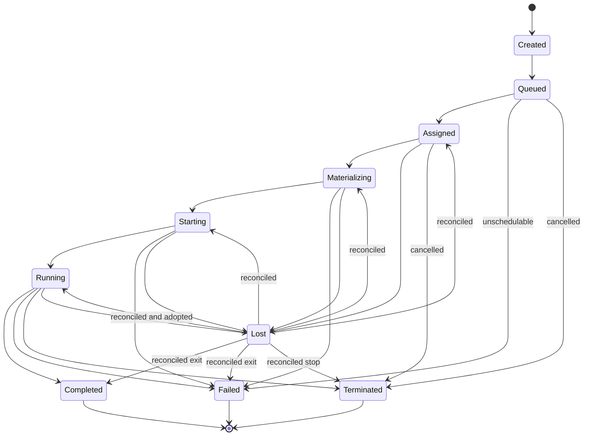

# 2. Core model (`pluribuscore`)

`pluribuscore` holds platform-independent definitions with nearly zero runtime policy. It MUST NOT
include host OS headers and depends on no other Pluribus module.

## 2.1 Strong identifiers

| Type | Meaning | Proposed representation |
|------|---------|-------------------------|
| `NodeId` | Stable node identity | UUID, persisted by node (Q-10) |
| `ExecutionId` | One execution | Immutable identity, separate from friendly short ID/name (Q-10) |
| `ArtifactId` | Content hash | SHA-256 (32 bytes) |
| `ServiceId` | Registered service instance | master-assigned |
| `PackageId` | Package identity | name + version (+ content hash of `.plp`) |

Rules: distinct C++ types (no implicit conversion), no raw strings internally, canonical text form
for CLI/logs.
Node name is separate, initially derivable and configurable/changeable; the CLI accepts name or UUID.

## 2.2 ExecutionSpec

Immutable once submitted.

| Group | Field | Notes |
|-------|-------|-------|
| Identity | `executable` | Explicit package, local client file, immutable artifact or exact package version reference (Q-5) |
| | `package` | Optional `PackageId` |
| Arguments | `args[]` | Strings in logical form |
| | `env` | Explicit map; clean base environment, no host inheritance |
| | `workdir` | Working directory within the sandbox; prefer relative paths (Q-23) |
| Inputs | `inputs[]` | `{artifact, logical path, mode ro/rw}`; directory manifests later |
| Outputs | `outputs[]` | Declared logical paths to collect as artifacts |
| Lifecycle | `lifetime` | `finite` or `persistent` |
| Services | `exports[]` | Service names the execution will publish |
| Constraints (optional) | `arch`, `requiredCaps`, `preferredCaps`, `minMemory`, `minCpu`, `devices`, `explicitNode` | Everything optional; derive from package where possible |
| Meta | `labels` | Optional opaque key/value for filtering and correlation; never interpreted by scheduler (Q-11) |
| Meta | `owner` | Optional ownership and notification, independent of client connection (Q-21) |

Non-fields (intentionally): job type, build target, domain-specific hints.

## 2.3 ExecutionHandle

Returned immediately on submit; never blocks.

Data: `ExecutionId`, state, assigned `NodeId`, service endpoints, stdout/stderr streams.

Operations:

| Operation | Semantics |
|-----------|-----------|
| `wait(timeout?)` | Wait until a definitive terminal state or provisional `Lost`; later reconciliation may revise `Lost` |
| `terminate()` | Graceful stop request (SIGTERM-like, logical) |
| `kill()` | Forced stop |
| `queryState()` | Current state + reason/exit info |
| `subscribeLogs(from?)` | Replay retained timestamped stdout/stderr separately, then stream live (Q-12) |
| `queryService(name)` | Resolve exported service |
| `fetchOutputs()` | Obtain output artifacts |

Identical for finite and persistent executions.

## 2.4 State machine

Terminal states: `Completed` (exit 0), `Failed` (non-zero exit, materialization/launch error,
or incompatibility under master policy), `Terminated` (stopped on request). `Lost` means the outcome
is unknown after node/fabric failure and can be reconciled (Q-13).

Rules:
- The master is the sole authority for state; nodes report events.
- Events are sequenced and handled idempotently; reconciliation may revise `Lost`.
- State MUST NOT be derived from connection state.
- Every terminal state carries a structured reason (`exitCode`, `signal`, `errorCode`, message).
- Reconnecting nodes report active IDs; adopt known executions when identity is proven and apply the
  configured orphan policy to unknown/stale executions. Prefer adoption for persistent executions (Q-13).

## 2.5 NodeDescriptor

Static: `NodeId`, configurable node name, protocol version, ABI version, architecture, logical CPU
count, total memory, accelerator classes and persistent device capabilities. Host OS is not normally
a scheduling capability (Q-14).

Dynamic: CPU utilization, available memory, running execution count, cache summary, accelerator
utilization, health.

Capabilities are extensible dotted names (`gpu.cuda`, `target.thor`, `device.radar.front`,
`vehicle.can`, `sensor.camera.360`). CPU and RAM stay quantitative.

Decision (Q-14): Automatically detect reliable hardware/runtime capabilities and configure
environment-specific capabilities on the node.

## 2.6 ServiceDescriptor

`{ServiceId, name, ownerExecution, node, endpoint, kind(stream/request-reply?), protocolTag?, health}`
Service semantics are described in [05-fabric-and-services.md](05-fabric-and-services.md).

## 2.7 Errors

Typed error codes (not host `errno`/`GetLastError`), grouped: protocol, scheduling, materialization,
launch, runtime, service, artifact, internal. Errors are serializable and carry
`component`, `nodeId?`, `executionId?`.

## 2.8 Serialization contract

Decision (Q-15): Benchmark FlatBuffers, Cap'n Proto and Protocol Buffers with representative control
messages before choosing serialization. Rules: explicit protocol version in every
connection handshake, forward-compatible field evolution, message-size limits, no host-specific
types in schemas.

## Knowledge base links

- Map: [Architecture map](../maps/architecture.md)
- Notes: [Execution](../notes/execution.md), [Execution lifecycle](../notes/execution-lifecycle.md), [Node](../notes/node.md), [Services](../notes/service.md)
- Decisions: [Decision records](../decisions/README.md), [Decision map](../maps/decisions.md)
- Open questions: [Open questions register](../questions/README.md)
