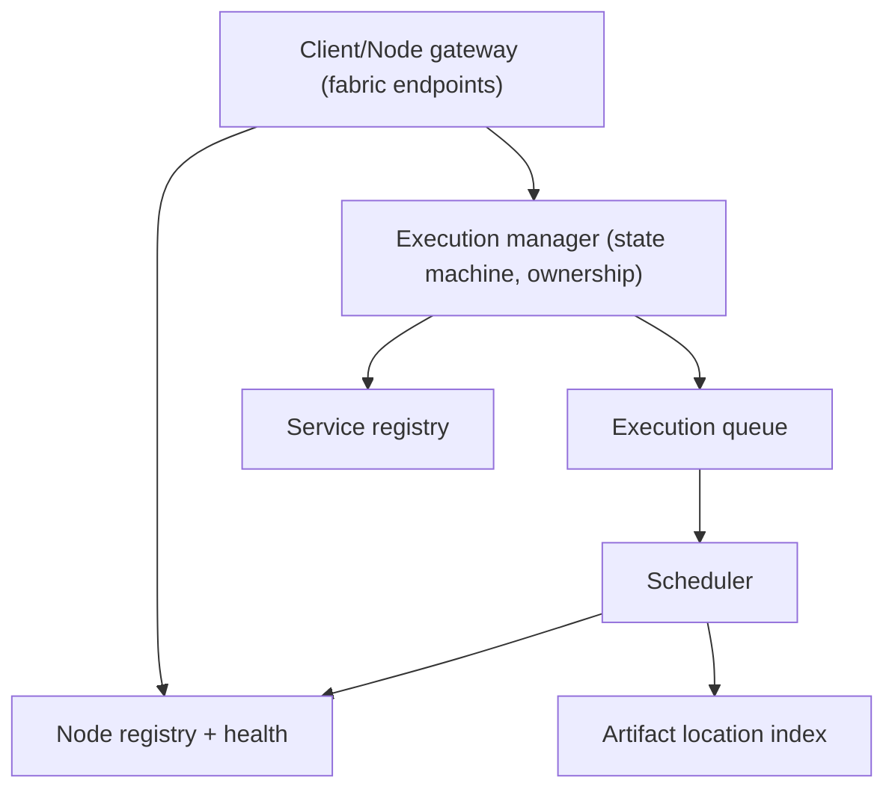

# 3. Control plane (`pluribusmaster`)

One authoritative master per Pluribus machine (V1). It does not execute applications unless the
same host also runs a `pluribusnode`.

## 3.1 Internal modules

| Module | Responsibility |
|--------|----------------|
| Node registry | Registration, descriptors, heartbeat, health timeout, drain state |
| Execution manager | Owns execution records & state machine, ownership, assignment, cancel |
| Queue | FIFO (V1), per-client fairness later |
| Scheduler | Pure function: spec + node state -> `NodeId` |
| Service registry | register / unregister / resolve / watch / health |
| Artifact index | Which node holds which `ArtifactId` (for locality) |

## 3.2 Scheduler

Pure and deterministic: no I/O, no domain knowledge, unit-testable in isolation.

Input: `ExecutionSpec`, snapshot of node states, compatibility info (from package manifest /
constraints), optional historical resource profile. Output: `NodeId` or `Unschedulable(reason)`.

Pipeline:

1. Determine compatibility (Pluribus ABI version, CPU architecture, package executable available; Q-3).
2. Remove unavailable/draining nodes.
3. Remove incompatible nodes.
4. Remove nodes missing mandatory capabilities / devices.
5. Evaluate resource availability (declared min memory/CPU vs. free, minus reservations).
6. Consider data/cache locality.
7. Score remaining candidates.
8. Select node.
9. Reserve resources.
10. Dispatch.

V1 scoring: compatibility mandatory; offline -> reject; insufficient declared memory -> reject;
otherwise lowest normalized load; local node as tie breaker. No prediction.

Design notes:
- Decision (Q-16): Resource declarations are optional overrides. Unspecified means unknown, not
  1 CPU/0 memory; master-configured default reservations provide accounting, not hard enforcement.
  Nodes report availability and measure actual usage; historical observations may inform later placement.
- Decision (Q-17): FIFO, no preemption. Compatible but busy nodes mean queue; when no current node
  supports the ABI/architecture, master policy decides whether to queue for a future node or fail.
- Scoring is a pluggable function interface so later policies don't touch the pipeline.

## 3.3 Node health

- Decision (Q-18): Master-configurable heartbeat; defaults are 1 s and unavailable after 5 misses.
- Health states: `Joining -> Healthy -> Suspect -> Unavailable -> (Healthy again | Removed)`.
- Heartbeats carry dynamic descriptor and event sequence ack.
- Master distinguishes **node failure** from **fabric failure** only by evidence: a node that
  reconnects with its running executions reports them; the master then reconciles.

## 3.4 Failure model

| Failure | Detection | V1 behavior |
|---------|-----------|-------------|
| Process failure | Node reports exit | `Failed`/`Terminated`; services removed |
| Node failure | Heartbeat timeout | Executions -> `Lost`; services removed; owner notified |
| Fabric failure | Same symptom as node failure | Same; reconcile on reconnect (Q-13) |
| Master failure | Nodes lose control connection | Running processes continue locally; no new scheduling; state considered lost/reconstructible |

Finite executions: `Lost`, optional caller-requested retry later. Persistent: `Lost`, notify owner,
no automatic restart elsewhere.

Decision (Q-19): Nodes keep supervising executions without an arbitrary termination timeout, hold or
reject new globally scheduled work, buffer events boundedly, reconnect and report active ExecutionIds.
Decision (Q-13): Master adopts known executions when identity is proven, preferring adoption for
persistent work; unknown/stale executions follow configured orphan policy.

## 3.5 Master state & persistence

Decision (Q-20): V1 may start in memory; reconstruct important identity and active state from node
reports. Durable history comes later behind a storage abstraction, not a SQLite-coupled master.

## 3.6 Client sessions & ownership

Decision (Q-21): Client connection and execution lifetimes are independent. Finite and persistent
executions continue on disconnect by default; persistent work can explicitly be tied to owner
lifetime. Retention is master-configured; foreground interrupt may request cancellation. `--detach`
returns without waiting.

## 3.7 Public client operations (master side)

connect, submit execution, get handle, observe state, stream stdout/stderr, terminate/kill,
resolve service, list nodes, list executions, list services. Nothing else is public in V1.

## Knowledge base links

- Map: [Architecture map](../maps/architecture.md)
- Notes: [Master](../notes/master.md), [Scheduler](../notes/scheduler.md), [Execution lifecycle](../notes/execution-lifecycle.md)
- Decisions: [Decision records](../decisions/README.md), [Decision map](../maps/decisions.md)
- Open questions: [Open questions register](../questions/README.md)
