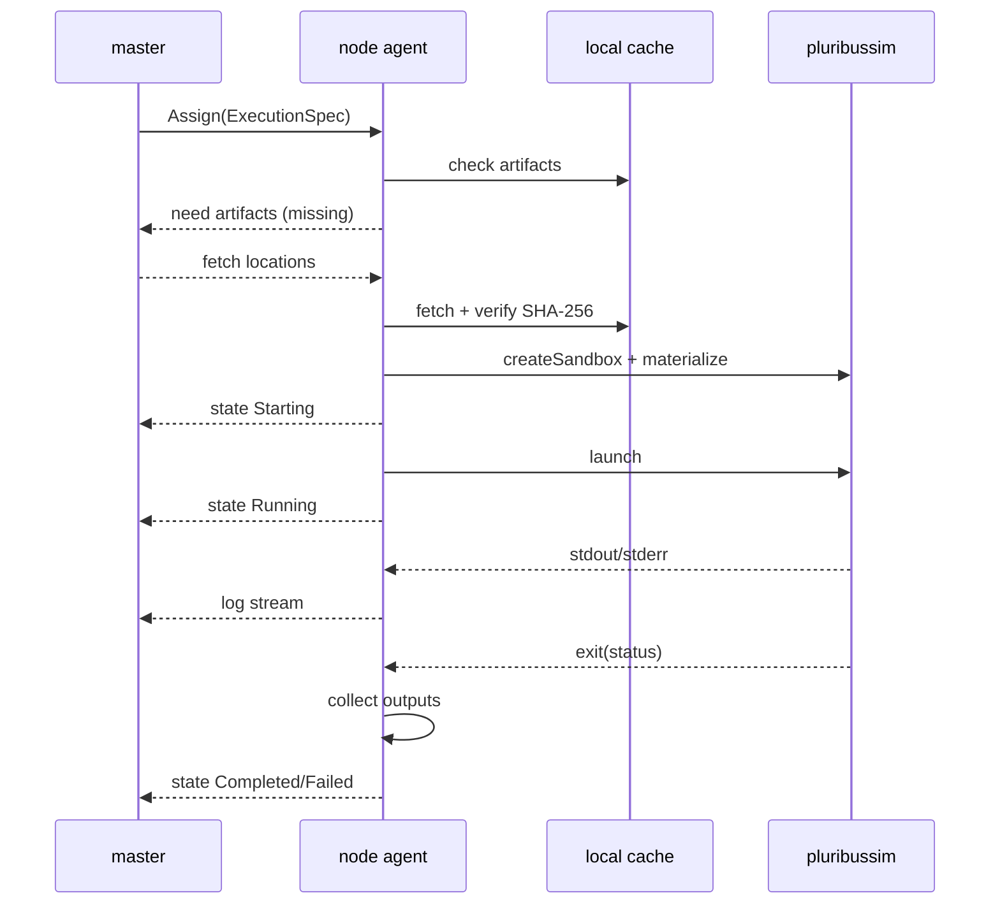

# 4. Node agent and runtime

## 4.1 `pluribusnode`

Deliberately simple. It has no understanding of why an execution exists.

Responsibilities: connect/register, report capabilities, heartbeat, receive assignments,
materialize inputs, create sandbox, invoke `pluribussim`, monitor process, collect resource
statistics, expose services, stream stdout/stderr, terminate executions, collect outputs, maintain
the artifact cache.

Internal modules: `agent` (control connection, registration), `executor` (execution lifecycle),
`monitor` (resource & process stats), `cache` (local artifact cache).

Per-execution node-side flow:



Node identity is persisted locally; the separate name is configurable. Decision (Q-22): TOML node
configuration includes capabilities, cache settings and master address. V1 runs foreground; host
service integration is later, with no automatic self-update initially.

Node lifecycle commands from master: assign, terminate, kill, drain, cache-evict hint.

## 4.2 `pluribussim`

Common runtime that removes host-OS differences. Depends on `pluribuscore` and a platform backend.

V1 responsibilities: process launch, consistent environment structure, sandbox-relative paths, environment
variables, execution sandbox, standard streams, process lifecycle, service registration
integration, resource measurements, host translation.

Explicitly **not** a Linux syscall ABI. The "ABI" in V1 is a *runtime contract* for natively built
binaries:

| Aspect | Contract (proposal) |
|--------|---------------------|
| Entry | Normal native executable (`main`), args and env as given in spec |
| Paths | Prefer paths relative to the assigned working directory; env vars bridge unavoidable host path cases (Q-23) |
| Streams | stdin/stdout/stderr standard; stdin closed unless requested |
| Services | Preferred C++ client API and local language-neutral node/runtime endpoint; ordinary TCP port forwarding later (Q-24) |
| Exit | Exit code propagates; termination = graceful signal then kill after grace |
| Libraries | Apps link a thin `pluribus-client` library (optional) for service APIs |
| ABI version | Integer, bumped on incompatible contract change; checked at scheduling |

Decision (Q-23): No filesystem virtualization in V1. Physical sandbox paths remain internal to the
node/runtime except where environment variables must bridge unavoidable cases. Consistent logical
filesystem semantics are a future ABI/runtime goal.

## 4.3 Host backend boundary

```cpp
// conceptual
class HostBackend {
  spawn(ProcessSpec) -> ProcessHandle
  stop(ProcessHandle); kill(ProcessHandle); query(ProcessHandle)
  createDirectory(Path); readFile(Path); writeFile(Path, bytes)
  createPipe(); createLocalEndpoint(Name)
  queryCpu(); queryMemory(); queryArchitecture(); queryAccelerators()
};
```

Implementations: `Win32HostBackend`, `LinuxHostBackend`, `MacHostBackend`, later
`DriveOSHostBackend` (initial target NVIDIA DRIVE AGX Thor / DRIVE OS Linux; Q-25). Validate its
actual toolchain and C++23 support before implementation; do not add Thor concepts to core.

Rules: public Pluribus types never expose backend types; backends are selected at build time
(CMake), one per target; most code compiles without platform headers.

## 4.4 Execution sandbox

Conceptual layout: `input/`, `work/`, `output/`, `tmp/` within each execution's working area.

Physical examples: `C:\ProgramData\Pluribus\executions\<id>\...`,
`/var/lib/pluribus/executions/<id>/...`.

V1 isolation is **operational, not security-grade**: separate directories, clean environment,
path-traversal protection, confinement checks on materialization. Decision (Q-26): Master-configured
retention defaults to short after success, longer after failure, and while active for persistent
executions. Sandboxes are not permanent storage; persistent artifacts belong in the store.

Hardening roadmap (not V1): Windows Job Objects, Linux namespaces/cgroups/seccomp, macOS sandbox,
privilege separation.

## 4.5 Process management details

- Process tree handling: terminate/kill must cover child processes (Job Objects / process groups).
- Resource measurement: CPU time, RSS/working set, per-execution where possible. Decision (Q-27):
  Represent GPU capabilities/resources with room for devices, VRAM and future allocation, but no
  complex allocation or migration in V1.
- Decision (Q-12): Capture stdout and stderr separately, timestamp chunks, keep bounded node history
  (initially about 10 MiB per execution, master-configurable), replay to late subscribers then stream live.
  Applications need no Pluribus-specific logging.
- Signals: Pluribus defines `terminate` and `kill` only; mapped per host.

## Knowledge base links

- Map: [Architecture map](../maps/architecture.md)
- Notes: [Node](../notes/node.md), [Runtime](../notes/runtime.md), [Sandbox](../notes/sandbox.md)
- Decisions: [Decision records](../decisions/README.md), [Decision map](../maps/decisions.md)
- Open questions: [Open questions register](../questions/README.md)
