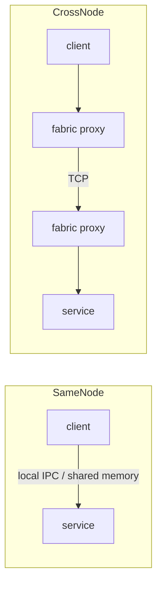

# 5. Fabric and services

## 5.1 `pluribusfabric`

Communication substrate between Pluribus components. Two conceptual planes:

| Plane | Traffic | Properties |
|-------|---------|------------|
| Control | registration, heartbeat, execution request/state, resource updates, service registration, terminate, errors | Small messages, latency-sensitive, never blocked by data |
| Data | artifacts, application streams, RadarScape data, logs, recordings | Large, throughput-oriented, flow-controlled |

A 2 GB recording MUST NOT delay a terminate message: separate connections (V1) with independent
buffers and back-pressure.

## 5.2 V1 transport

- TCP; no raw Ethernet protocol.
- One long-lived **control connection per node** (node -> master, node dials out; helps with NAT/firewalls).
- Separate **data connections**, opened on demand.
- Length-prefixed binary frames, explicit protocol version in handshake.
- Decision (Q-28): 1 MiB control-message limit; large payloads use the data plane.
- Node-to-node data connections allowed (artifact fetch, service traffic) with endpoint info from master.

Frame sketch:

```
| u32 length | u8 version | u8 type | u16 flags | u64 seq | encoded payload |
```

Handshake: `Hello{protocolVersion, role, nodeId?, auth?}` -> `Welcome{negotiatedVersion, sessionId}`
or `Reject{reason}`.

Later candidates (only after profiling): TLS, QUIC, compression, RDMA, shared-memory transport,
zero-copy networking.

## 5.3 Reliability semantics

- Control messages: retry-safe idempotent operations, sequence numbers and acknowledgments; execution
  submission uses a client-generated request ID to avoid duplicate execution (Q-28).
- Reconnect: node reconnects with backoff, resumes session or re-registers.
- Heartbeat is a control message; missing heartbeats are the *only* liveness signal.
- Decision (Q-29): Static master address configuration in V1; optional discovery such as mDNS later.

## 5.4 Service model

Persistent executions export logical services; consumers use logical names:

`pluribus://radar-slave/control` (also written `radar-slave/control` in APIs).

Registry mapping: logical name -> provider instance (`ServiceId`, `ExecutionId`, `NodeId`, endpoint).

Decision (Q-30): Hierarchical names such as `radarscape/sar/output` identify stable logical services
independently of individual provider instances and location. Decision (Q-31): The protocol permits
multiple providers; V1 resolves one active provider per service. Load balancing/redundancy can follow.

### Routing



Resolve returns a **connection recipe**, not an address to cache: the client library asks Pluribus
to connect to the service name; Pluribus chooses same-node local transport or a fabric-proxied
stream. If the provider moves, reconnect re-resolves.

Decision (Q-32): V1 service kinds:
- **Byte stream** (reliable, ordered, bidirectional) — the minimum.
- Message framing/request-reply left to applications (or a thin helper) initially.
- The abstraction allows later datagrams, request/reply, publish/subscribe, high-throughput streams,
  and same-node shared memory.

Proxy path options for V1:
- (a) Always via master (simplest, adds hop + master load) — acceptable only for control-sized traffic.
- (b) Master resolves, then node-to-node direct data connection brokered by master (recommended).

Overhead target: < 2 ms additional on local wired LAN for small round trips.

### Registry operations

`register`, `unregister`, `resolve`, `watch` (notify on change), `health/query`.
Registrations are bound to execution lifetime: when the execution reaches a terminal state, its
services disappear automatically; applications never clean up stale entries.
Decision (Q-33): Creating or declaring a service does not make it ready. The application marks it
`READY` after initialization; only then does the resolver expose it. Resolve supports wait/timeout.

## 5.5 Host-independent networking

For Pluribus services, applications use logical names such as `connect("sar-worker/data")` instead of
physical addresses. Decision (Q-34): Normal TCP, UDP, CAN, sensors and external equipment remain
accessible; Pluribus is not a general virtual network stack. Future same-node shared memory can
replace service transport without changing the application protocol.

## 5.6 Public API surface (V1)

Decision (Q-6, Q-35): Connect, submit, handle (state/wait/terminate/kill/logs), resolve/connect
service via a C++23 client library in `pluribus::` and a documented language-neutral wire protocol.
The CLI uses the public interface; protocol schemas do not expose C++ types or class layouts. No
stable C ABI is required initially; avoid implementation-specific public types to permit later bindings.

## Knowledge base links

- Map: [Architecture map](../maps/architecture.md)
- Notes: [Fabric](../notes/fabric.md), [Services](../notes/service.md)
- Decisions: [Decision records](../decisions/README.md), [Decision map](../maps/decisions.md)
- Open questions: [Open questions register](../questions/README.md)
