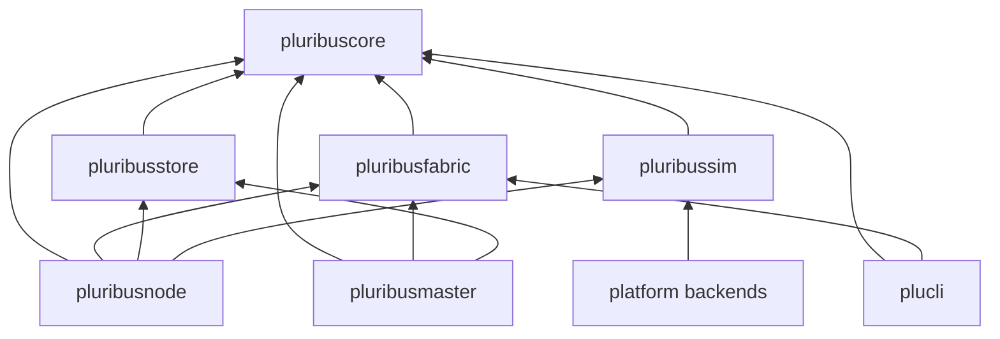

# 8. Roadmap, layout and scope

## Project scope

Decisions (Q-1, Q-2, Q-7): Start from scratch and remain domain-agnostic. RadarScape distributed
workers are the first driver, followed by distributed build/test and experimentation. Target 2–10
nodes and well below 1000 concurrent executions initially without precluding larger deployments.

Decision (Q-8): The name is Pluribus, namespace `pluribus::`, CLI `plu`. Select a standard free
license requiring attribution before publication; evaluate MIT, Apache-2.0 and BSD-3 rather than
inventing a custom license.

## Repository layout

Single repository initially; boundaries stabilize first.

```
pluribus/
  CMakeLists.txt, cmake/
  core/      types, execution, node, resources, services, artifacts, protocol
  master/    registry, scheduler, execution_manager, service_registry
  node/      agent, executor, monitor, cache
  runtime/   pluribussim, sandbox, environment
  platform/  win32, linux, macos
  fabric/    protocol, transport, connection, streams
  store/     artifact, hash, local_cache
  cli/       plu
  tests/     unit, integration, system
  docs/
```

## Dependency direction



Note: backends are a dependency *of* `pluribussim` in the source (idea), meaning `sim` links a
backend selected at build time; diagram arrow shows the compile-time implementation relation.

Decision (Q-43): Forbid `core -> platform` or host OS, `master -> RadarScape`,
`scheduler -> application domain`, and `fabric -> RadarScape`; master also does not depend on CMake
or Thor application concepts. Enforce with CMake target boundaries and CI dependency checks where practical.

## CLI (`plu`)

| Command | Purpose |
|---------|---------|
| `plu nodes` | Registered nodes + resource state |
| `plu run <exe> [args]` | Run finite execution, wait, stream stdout/stderr and return remote exit code |
| `plu run --detach <exe> [args]` | Return immediately with ExecutionId; execution continues |
| `plu ps` | List executions |
| `plu logs <id>` | Stream logs |
| `plu stop <id>` | Terminate execution |
| `plu services` | List services |
| `plu resolve <service>` | Test discovery |

Decision (Q-44): Support `--json`; configuration precedence is CLI > environment > user config >
system/default config. Foreground interrupt may request cancellation. `plu` uses the public API.
Executable source syntax is specified in [06-store-and-packaging.md](06-store-and-packaging.md#65-packages-plp).

## Documentation priorities

Decision (Q-46): Specify, in order: execution model/state machine; node/master protocol; C++23 public
API; service model/lifecycle; wire protocol/reconnect/idempotency; node/runtime boundary; scheduler V1;
artifact/store protocol; repository/CMake target structure; security model. See the
[specification index](../README.md#specifications-in-priority-order).

## Prototypes

| # | Prototype | Success criterion |
|---|-----------|-------------------|
| 1 | Remote hello (2 machines) | `plu run hello` returns stdout and remote exit code on A, executed on B |
| 2 | Persistent service | Client resolves `radar-slave/control` without ever knowing the IP |
| 3 | Heterogeneous nodes (Windows + Linux) | `plu run hello` runs on either host, same command |
| 4 | Architecture packaging (x86_64 + arm64) | Same command, correct binary chosen per node |
| 5 | RadarScape worker | Synthetic radar data processed remotely via a registered service |

## Milestones

| M | Scope | Exit criteria |
|---|-------|---------------|
| A–D First end-to-end slice | Minimal core model, fabric, node registry, queue/scheduler, package resolution/materialization, remote runtime launch and CLI | Prototype 1: client → master → scheduler → remote node → runtime → hello → stdout and exit code returned |
| E Lifecycle | `plu ps`, `plu stop`, persistent executions, node-loss detection | `Lost` state demonstrated |
| F Services | register, resolve, proxy/forward, lifetime binding | Prototype 2 |
| G Artifacts | Extend minimal artifact transfer/materialization with cache and outputs | Cache hit on second run |

Decision (Q-46): Implement and verify the first end-to-end `plu run hello` before expanding into
RadarScape workers, distributed builds, Thor, advanced scheduling or Linux ABI work. Subsequent
milestones can add richer packaging and heterogeneous ABI support after the runtime contract is
prototyped. Decision (Q-9): Timeline/team are undecided; development is milestone-driven.

## Non-goals

Linux syscall emulation, modified musl, distributed POSIX filesystem, master clustering,
scheduling AI, predictive load models, process migration, transparent distributed RAM, containers,
Kubernetes, sophisticated sandboxing, GPU workload migration, ARM emulation, raw Ethernet
protocol, automatic compiler integration.

## Long-term picture

Machines (workstation, Linux build PC, Thor, GPU workstation, AI worker, CI machine) contribute
resources; applications see executions, services, artifacts, capabilities — not machines. A
RadarScape deployment could request UI, radar decoder, SAR/OGM/AI processors, recording and
visualization services and let Pluribus place them.

## Reviewing this documentation

The answered questionnaire is a local, not committed source note; the decisions are captured in
these documents and the [decision index](../README.md#decisions).
