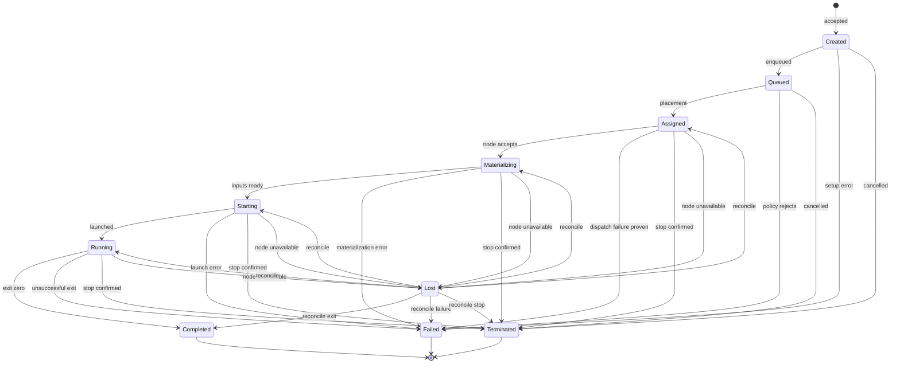

# 01. Execution model

Status: design specification for V1; exact API and encoding remain provisional. An execution is one run of a native Pluribus-compatible executable, not a domain-specific job. Pluribus is a uniform distributed execution environment, **not a Linux simulator**. Compatibility is determined by Pluribus ABI and CPU architecture, not host OS; the mechanism that makes this portable still requires prototyping. There is no CPU emulation in V1.

See the [protocol](02-node-master-protocol.md), [C++ API](03-cpp-public-api.md), [services](04-service-model.md), [wire](05-wire-protocol.md), [runtime boundary](06-node-runtime-boundary.md), [scheduler](07-scheduler-v1.md), and [store](08-artifact-store-protocol.md).

## Identity and request

`ExecutionId` is an immutable, globally unambiguous identity for one run, distinct from any friendly short ID or name shown by the CLI. A short ID is a lookup convenience, never an identity on the wire; reject ambiguous prefixes. `NodeId` is a persisted UUID; the separately configurable node name is mutable, may be auto-derived and is not identity. CLI node selection accepts UUID or name and rejects ambiguous names. Artifact IDs identify content; service names and provider instance IDs are distinct from execution IDs.

An `ExecutionSpec` is immutable after acceptance. Fields below are logical types, not C++ layouts or a chosen serialization schema.

| Field | Meaning and V1 semantics |
|---|---|
| `request_id` | Client-generated unique ID for an intended submission, reused unchanged on retry; scoped to the client identity and retained as described in [wire](05-wire-protocol.md). |
| `executable` | Explicit source: `hello` resolves package name, `hello@1.4.2` selects an exact package version, `./hello` uploads a client-local file as an ephemeral artifact/package, and `artifact:sha256:<digest>` selects exact content. No node-local PATH lookup or implicit source precedence. Resolve a mutable package name once on acceptance and record the selected immutable content/metadata. |
| `arguments`, `environment` | Ordered argument strings and explicit key/value environment overrides; runtime constructs a clean environment. |
| `working_directory` | Optional sandbox-relative logical path; default execution work directory. V1 applications should use relative paths, not assume filesystem virtualization. |
| `inputs` | Artifact references with sandbox-relative destinations and read-only/read-write intent. |
| `outputs` | Optional sandbox-relative output paths to collect as artifacts. |
| `lifetime` | `finite` or `persistent`; describes intended lifetime, not different identity, restart, or scheduling semantics. |
| `owner_policy` | Default independent of client connection; explicit owner-lifetime coupling may be requested. Owner identity and retention are distinct from TCP connection lifetime. |
| `services` | Optional declared hierarchical logical names; declaration alone is not readiness. |
| `resources` | Optional quantitative CPU/memory requirements or overrides. Omitted means **unknown**, not zero or one CPU; master-configured reservations apply internally. Accounting, not hard enforcement, in V1. |
| `constraints` | Optional architecture, ABI, required/preferred capabilities, devices and explicit node. Derive compatibility from executable metadata where possible. See [scheduler](07-scheduler-v1.md). |
| `labels` | Optional opaque string key/value metadata for filtering, grouping and correlation; the scheduler **never interprets labels**. |

The API submit returns a handle on acceptance, not on completion. `plu run hello` normally waits, streams stdout/stderr and returns the remote exit code; `plu run --detach hello` returns the ID immediately. Detach changes client waiting/ownership behavior, not the execution's lifetime class; closing a connection alone does not stop either kind. Foreground interrupt may explicitly request cancellation. An explicit owner-lifetime policy requires an owner lifecycle independent of socket liveness.

## Handle, observation and logs

An `ExecutionHandle` references the ID and supports query, wait, terminate, kill, log subscription, service resolution and output lookup. Its state snapshot includes state, master revision, assigned node when known, and structured reason/exit information. A handle can be reacquired by ID while the master retains the record. `wait` returns on a definitive terminal state **or Lost**; callers must inspect the result and may later observe reconciliation. A wait timeout is not an execution failure.

Node captures ordinary stdout and stderr separately, with timestamped chunks and bounded history (initially about 10 MiB per execution, master-configurable). A subscriber gets retained history followed by live data without an unreported gap; if history was evicted or continuity cannot be proven, report a gap explicitly. Ordering is per stream, not a total order across stdout and stderr. Output artifacts may only be available after collection and are subject to configured retention.

## State and events

The master owns the authoritative state; node reports are evidence, not independent authority. `Completed`, `Failed`, and `Terminated` are definitive terminal states. `Lost` is a **provisional terminal observation**, outcome unknown, which may be corrected only by reconciliation with sufficient identity and outcome evidence. Neither disconnect alone nor a client timeout proves process exit. Do not silently retry or migrate a Lost execution.

| Event and emitter | Preconditions | Transition / result |
|---|---|---|
| `SubmitAccepted`, master | Valid new request; idempotency record established | create `Created`; enqueue to `Queued`. Duplicate returns original ID. |
| `Placement`, master | `Queued`, compatible available node, reservation made | `Assigned`; send assignment with unique assignment identity. Busy stays queued; no compatible node queues or fails according to master policy. |
| `AssignmentAccepted`, node | Matching current assignment, not already accepted | `Assigned` to `Materializing`; duplicate assignment never launches a second process. |
| `InputsReady`, node | Materialization completed | `Materializing` to `Starting`. |
| `Started`, node | Launch confirmed | `Starting` to `Running`. |
| `Exited`, node | Process exit confirmed, output collection attempted | `Running` to `Completed` for exit 0 or `Failed` for nonzero/abnormal exit; retain portable exit details. Collection failure is reported separately, not silently treated as success. |
| `ExecutionError`, master or node | Before terminal state; error is proven, e.g. policy rejection, materialization, dispatch rejection, or launch error | `Failed` with stage and portable error code. A dispatch timeout alone is not proof of failure. |
| `StopRequested`, client via master | Any nonterminal state | Acknowledge request, not completion. Before assignment master can cancel immediately; after assignment send graceful terminate or forced kill to node. |
| `StopConfirmed`, master or node | No process could have been launched, or node confirms requested stop | `Terminated`, reason `cancelled`, `terminated`, or `killed`. If exit won the race, report actual exit instead; repeated stop is safe. |
| `NodeUnavailable`, master | Assigned node crosses configured heartbeat threshold; outcome not known | `Assigned`, `Materializing`, `Starting`, or `Running` to `Lost` with node-unreachable reason; remove providers from resolution, notify observers. |
| `Reconcile`, node report validated by master | `Lost`, same node and matching execution/assignment identity; report has credible state or retained outcome | Restore the proven active stage, or correct to the proven definitive terminal outcome. Publish a new master revision with reconciliation reason; do not make a new execution. |

The master assigns a monotonically increasing **execution revision** to each published state change, including correction from `Lost`. The node assigns a monotonically increasing **event sequence per assignment**, persisted/buffered as available, to lifecycle reports. Master deduplicates by assignment and sequence, detects gaps and requests replay or a reconciliation snapshot rather than applying out-of-order transitions. A master revision is not a node event sequence or wire-frame sequence. A snapshot can cover intermediate transitions after a gap; it must carry the latest node event sequence and enough evidence for the reported stage/outcome. Definitive terminal outcomes are not replaced by ordinary late events. See [wire sequencing](05-wire-protocol.md#sequencing-retry-and-resumption).

## Reconnect, orphans and master loss

On master loss nodes keep supervising existing processes, buffer bounded events, accept no new globally scheduled work and reconnect. On reconnect they report active IDs, assignment identities, state and available retained outcomes/services. A known, matching execution is adopted if still active, including finite runs; persistent runs particularly favor adoption. A known Lost run with a verifiable retained exit is corrected to its outcome. Services become resolvable again only after provider identity and readiness are revalidated. Retained history is finite: missing proof remains `Lost`, not assumed complete.

Unknown, stale, conflicting or unprovable reports are **orphans**. Apply configured orphan policy; the conservative V1 behavior is keep locally supervised and non-resolvable while awaiting reconciliation/operator policy, rather than automatically kill or publish. Adoption requires verifiable identity and sufficient metadata; never associate a process merely by name. An explicit policy can stop an orphan. In-memory master restart can lose request mappings and execution history: reconstruct what node evidence proves, but do not claim exactly-once submission or universal recovery across a master crash. No automatic duplicate restart follows a loss.

## Open issues

- ExecutionId representation, owner identity/lifetime mechanism, orphan policy controls and retention durations require implementation design.
- The portable native ABI mechanism and compatibility metadata validation require a prototype; cross-OS execution is not assumed to work merely because ABI and architecture labels match.
- Precise exit-status portability and whether output-collection failures alter final execution outcome need specification.
