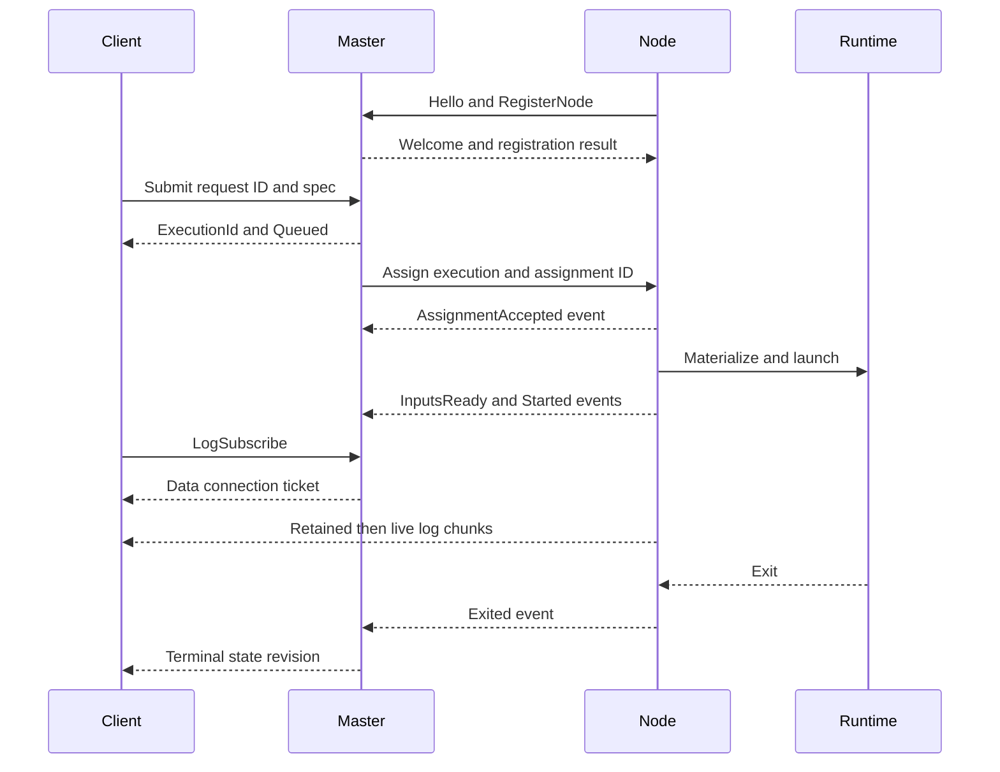

# 02. Node/master and client control protocol

This catalog defines logical messages, not a binary schema or C++ layout. The [wire specification](05-wire-protocol.md) defines framing, session sequences, retries and limits; [execution](01-execution-model.md), [services](04-service-model.md), [runtime boundary](06-node-runtime-boundary.md), [scheduler](07-scheduler-v1.md), [store](08-artifact-store-protocol.md), and [security](10-security-model.md) define domain semantics. The master is authoritative; nodes supervise local executions. Clients use the same control protocol as the CLI.

## Common envelope and conventions

Each request has a request ID for response correlation; mutating request IDs also provide deduplication within the stated scope and retention. Responses echo the ID and carry either result or a portable error. Messages use the negotiated version, role, session and directional frame sequence; payload fields below omit that envelope. `?` means optional, `[]` repeated. `ExecutionId`, `NodeId` UUID, assignment ID, service provider ID and artifact digest are distinct typed logical values. Names are display or logical names, not node identity. Per-execution `event_seq` is separate from frame sequence and master `revision`. Numeric message-type IDs for these catalog messages are now assigned in [`control.proto`](../../fabric/proto/control.proto); the envelope dispatch key is the frame `type` byte.

## Session, node and execution messages

| Message (direction) | Payload fields | Result and rules |
|---|---|---|
| `Hello` / `Welcome` / `Reject` (node or client → master; master → peer) | role, supported protocol versions, capabilities, client identity or NodeId?, prior session and ack positions?, join token for node? / selected version, session ID, resume status, limits / code, detail | Negotiate before application messages; resume only when both sides retain matching session state. Join token is not transport encryption. |
| `RegisterNode` / response (node → master) | NodeId, configurable name, descriptor, node incarnation, active inventory summary / accepted configuration, heartbeat interval, reconciliation requirement | Persisted UUID identifies node; incarnation distinguishes restart. Registration does not by itself prove reported processes belong to old assignments. |
| `Heartbeat` / ack (node → master) | NodeId, incarnation, health, descriptor revision, optional resource snapshot / acknowledged heartbeat and control sequence | Default interval 1 s; default unavailable after 5 missed, master-configurable. Missing heartbeats indicate unavailability, not proof of process death. |
| `DescriptorUpdate` / ack (node → master) | NodeId, descriptor revision, full descriptor or explicitly based delta; architecture, Pluribus ABI, CPU/RAM totals and availability, detected/configured capabilities, load, cache summary | Reject unknown delta base and request full snapshot; never use host OS as a normal scheduling capability. |
| `Submit` / response (client → master) | client-generated request ID, immutable ExecutionSpec / ExecutionId, current state, revision, resolved executable identity | Same ID and same request returns same execution; changed request yields conflict. Admission is not launch. |
| `GetExecution` / response (client → master) | ExecutionId / state, revision, assigned NodeId?, reason?, output references? | Snapshot; Lost is provisional. |
| `Assign` / ack (master → node) | ExecutionId, assignment ID, immutable resolved spec, reservation?, selected ABI/architecture, input refs / accepted or error | Idempotent by assignment ID; never launch twice for a duplicate. Timeout is not proof of rejection. |
| `StateEvent` / ack (node → master) | ExecutionId, assignment ID, event_seq, event kind, stage, timestamp, reason/exit?, output refs? / highest contiguous event_seq | Master validates transition and identity, deduplicates, detects gaps. Acks indicate accepted contiguous events, not client observation. |
| `WatchExecution` / event (client → master) | ExecutionId, after_revision? / snapshot or state, revision, reason | Observe ordered revisions; if retention cannot cover cursor, return a snapshot and explicit gap. |
| `Terminate` or `Kill` / response (client → master → node) | request ID, ExecutionId, assignment ID on node leg, mode / accepted, already-terminal or error | Request acknowledgement is not proof of process stop. Idempotent; final result comes from state events. |
| `ReconcileRequest` / `ReconcileReport` (master ↔ node) | NodeId, incarnation, inventory generation, pagination cursor? / active executions with assignment IDs, stage, last event_seq, retained outcomes, service instances/readiness; completeness marker | Complete inventory before declaring an item absent; master verifies identity and returns adoption/orphan decisions. Event gaps require replay or snapshot; unavailable evidence stays unknown. |
| `ReconcileDecision` / ack (master → node) | ExecutionId, assignment ID, action: adopt, hold, or stop, master revision? | Adoption resumes supervision, not a fresh launch. Hold unknown orphans locally and non-resolvable until configured policy decides. |

## Logs, services and artifacts

| Message (direction) | Payload fields | Result and rules |
|---|---|---|
| `LogSubscribe` / response (client → master, master brokers node) | ExecutionId, stdout/stderr selection, per-stream cursor?, follow / data connection ticket, retained range, gap indication | Timestamped chunks use data plane; replay retained history then live without silent gaps. No unlimited control payload. |
| `ServiceRegister` / response (node → master) | ExecutionId, assignment ID, logical name, provider instance ID, endpoint descriptor, supported mode / registration revision | Created provider is not ready; execution and assignment must be valid. Endpoint is internal routing metadata, not a public host handle. |
| `ServiceReady` / response (node → master) | provider instance ID, ExecutionId, readiness boolean, provider generation / registry revision | Provider application explicitly signals readiness through node/runtime; only ready, reachable providers resolve. |
| `ServiceUnregister` / response (node → master) | provider instance ID, generation / registry revision | Idempotent; terminal execution removes all providers automatically. |
| `ServiceResolve` / response (client → master) | logical name, supported mode, timeout / provider instance ID, generation, opaque connection recipe or not-found/timeout | V1 selects at most one ready provider. Resolve and connect can race; client must re-resolve after failure. |
| `ServiceWatch` / event (client → master) | logical name, after registry revision? / snapshot or change, revision, gap? | Registry changes include readiness/removal; gap triggers fresh snapshot. |
| `ArtifactLocationQuery` / response (node or client → master) | artifact SHA-256 ID / known location descriptors, metadata?, index revision | Locations are hints, not proof of availability. Blob bytes use data plane, verified by hash. |
| `ArtifactLocationUpdate` / response (node → master) | NodeId, artifact ID, present/removed, size?, cache generation / accepted | Index update is idempotent; eviction and disconnection can make cached hints stale. See [store protocol](08-artifact-store-protocol.md). |

## Normal execution and reconnect



```mermaid
sequenceDiagram
    participant N as Node
    participant M as Master
    participant C as Client
    Note over N,M: Connection lost; node keeps supervising
    M-->>C: Lost revision after heartbeat timeout
    N->>M: Hello with resume cursor
    M-->>N: Resume or new session
    N->>M: Register and reconciliation inventory
    M->>M: Verify assignment identity and evidence
    M-->>N: Adopt known or hold orphan
    M-->>C: Reconciled state revision
```

Data connections in the first diagram are logical: the chosen route may use a broker rather than a direct node-to-client socket. Tickets are short-lived routing capabilities, not a promise of encryption or secure authentication in V1.

## Error codes

| Code | Meaning / caller action |
|---|---|
| `INVALID_ARGUMENT`, `MESSAGE_TOO_LARGE` | Invalid field or limit exceeded; correct request. |
| `UNSUPPORTED_VERSION`, `UNSUPPORTED_FEATURE` | Negotiate a compatible version/feature or fail. |
| `UNAUTHORIZED` | Join or operation rejected; do not blindly retry. |
| `NOT_FOUND`, `AMBIGUOUS` | Identity/name unavailable or lookup not unique. |
| `CONFLICT` | Same request ID with different content, stale generation or incompatible state. |
| `UNAVAILABLE`, `TIMEOUT` | No response or dependency unavailable; outcome may be unknown; retry with same ID when permitted. |
| `RESOURCE_EXHAUSTED`, `UNSCHEDULABLE` | Policy/resource limit or incompatible placement; queue/fail according to master policy. |
| `SEQUENCE_GAP`, `RESYNC_REQUIRED` | Replay missing retained events or request an authoritative snapshot. |
| `ARTIFACT_MISSING`, `INTEGRITY_ERROR` | No usable content source or hash mismatch; re-query or fail materialization. |
| `LAUNCH_FAILED`, `INTERNAL` | Launch or internal failure; include portable stage and diagnostic, never raw host handles. |

Responses include code, human-readable diagnostic and optional retry guidance and related IDs. Do not expose host-specific errors as API types. A timeout does not imply a mutation did not happen.

## Open issues

- Numeric type assignments are in `control.proto`, but most message bodies (types 20–79) are still schema-pending; endpoint-ticket format, authentication details and exact pagination limits depend on wire/serialization and security work.
- Exact client identity, request deduplication retention and master-restart durability remain to be decided.

## Knowledge base links

- Map: [Specification map](../maps/specifications.md)
- Notes: [Master](../notes/master.md), [Node](../notes/node.md), [Fabric](../notes/fabric.md)
- Decisions: [Decision records](../decisions/README.md), [Decision map](../maps/decisions.md)
- Open questions: [Open questions register](../questions/README.md)
