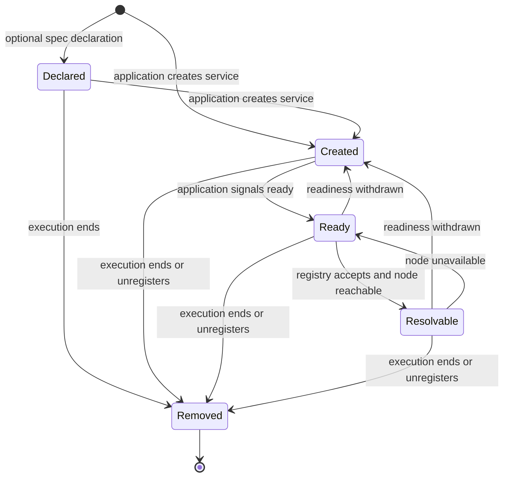
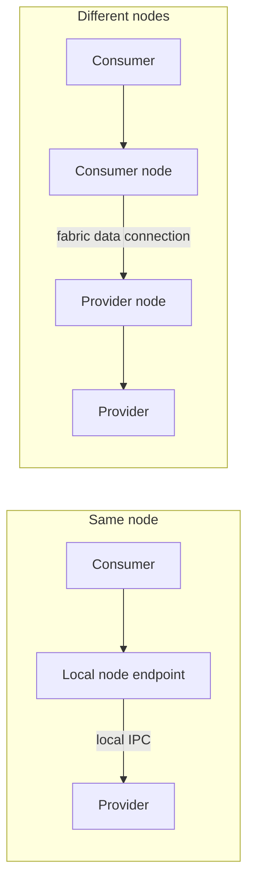

# 04. Service model

A service is a location-independent communication name such as `radarscape/sar/output`, not a physical socket address. The master owns the registry. A service can be exported by a finite or persistent execution; its lifetime is bounded by that execution. See [execution](01-execution-model.md), [control messages](02-node-master-protocol.md), [C++ API](03-cpp-public-api.md), [wire](05-wire-protocol.md), [runtime boundary](06-node-runtime-boundary.md), and [security](10-security-model.md).

## Names and providers

Names are hierarchical, slash-separated logical components, with no host or port. Treat a full name as an exact identifier; hierarchy supports organization, not implicit authorization or wildcard routing. Name normalization and the complete allowed character set must be specified before interoperability is frozen. A logical service is independent of its providers. A **provider instance** has a distinct ID/generation, logical name, owning ExecutionId, assignment ID, NodeId, stream mode, readiness and internal routing metadata. Re-registration or replacement must not accidentally reuse an old provider generation.

The model and messages permit multiple instances per logical service, but V1 resolution returns at most **one active ready provider**. V1 must reject a conflicting second active registration or otherwise keep it non-resolvable under an explicit deterministic registry policy; it must not encode a permanent one-provider restriction into identity or wire schemas. No load balancing or transparent failover is promised in V1.

## Readiness and lifetime

`Declared` is intent in an execution spec, not proof of an endpoint. `Created` means the provider has registered an endpoint through the node/runtime, not that it is initialized. The application marks it `READY` only after it can accept connections; master exposes a ready provider only while the matching execution and node are valid and reachable. `Ready` and `Resolvable` are registry observations, not a guarantee of future health. An application can withdraw readiness or unregister. On definitive execution termination all its registrations are removed automatically. On node unavailability or execution Lost, remove providers from resolution immediately but preserve enough identity/readiness evidence for reconciliation; never assume the process has stopped. Revalidated active instances can be exposed again after reconciliation and readiness verification.

`resolve(name, timeout)` waits for a matching resolvable provider until its deadline; zero timeout is a nonblocking lookup. It returns an opaque connection recipe and provider ID/generation, not a durable host address. A registry watch can emit snapshots and ordered changes with revisions; an uncovered history gap requires a fresh snapshot. A resolve can race with removal, so a connection may fail even after successful resolve. Re-resolve on reconnect rather than relying on a cached address.

## Transport and routing

The V1 minimum is a reliable, ordered, bidirectional **byte stream** per connection. It provides no message boundaries, transactional delivery, automatic replay or cross-connection ordering. Applications frame messages and implement request/reply as needed. Later modes can add message/datagram, request/reply, pub/sub and high-throughput streams; shared memory may optimize same-node traffic. These are extensions, not capabilities implicitly promised by the byte-stream mode.

Master resolves and brokers routing metadata on the control plane; actual bytes use a separate data path, preferably direct node-to-node when available. A broker/relay may be used in V1 without making the master a required permanent data bottleneck. Same-node local IPC is an implementation choice; shared memory is future optimization, not distributed shared memory. Control and data have independent backpressure. Routes and tickets are internal and short-lived; applications use names. Ordinary TCP/UDP, CAN and hardware access remain possible outside Pluribus services; Pluribus is not a general virtual network stack. Future TCP port forwarding may connect unmodified applications, but is not a V1 service guarantee.

Both the preferred C++ API and a documented language-neutral **local endpoint** provided by node/runtime must support service create, ready, accept, resolve and connect. Local endpoint addressing and authentication are implementation details, not application-visible physical topology; its protocol must be specified separately. [Security](10-security-model.md) defines the trusted-network boundary and limitations.

## Failure behavior

| Condition | Required behavior |
|---|---|
| Not yet ready | Resolve waits up to timeout or returns not found/timeout; declaration alone is never returned. |
| Provider exits/unregisters | Remove instance; existing streams close or fail, and new resolution excludes it. |
| Node unreachable | Unpublish instances, fail affected streams as transport permits, mark execution Lost; later reconcile identity/readiness. |
| Client or data connection drops | Report stream failure; no guarantee of byte replay or exactly-once application messages. Re-resolve and reconnect explicitly. |
| Master unavailable | Existing established data streams may continue if their route remains healthy; new global resolve/register operations cannot be assumed to succeed. |
| Registry changes between resolve and connect | Connect can fail; re-resolve. Never connect to a different generation merely because a stale name matched. |

## Open issues

- Exact service-name grammar, local endpoint protocol, route authorization/ticket format, and V1 duplicate-provider policy need to be fixed before interoperability.
- Readiness revalidation mechanism, shutdown/drain behavior and provider health semantics beyond explicit readiness remain to be designed.
