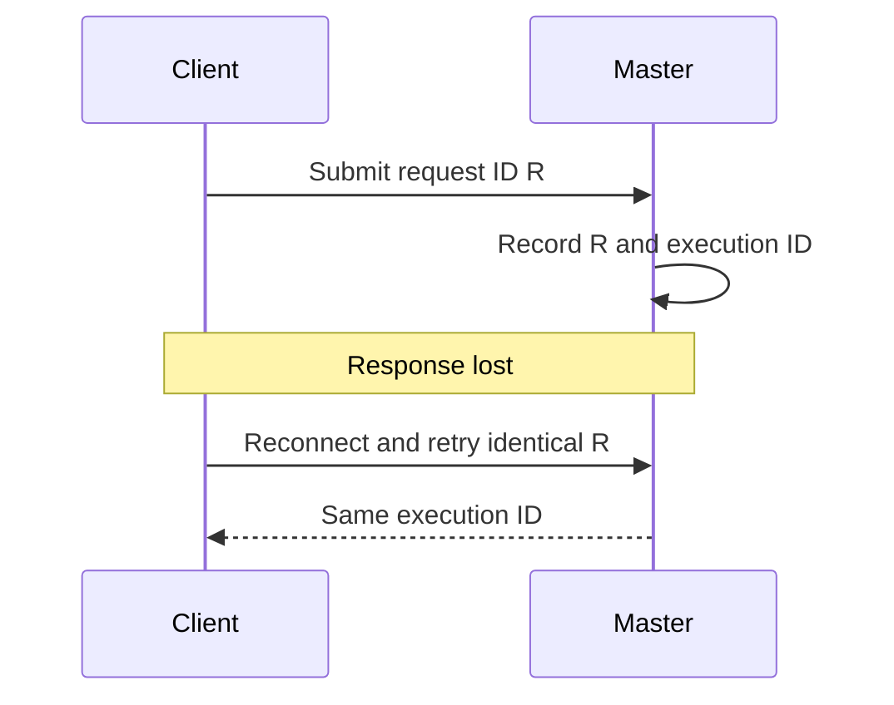

# 05. Wire protocol, retry and compatibility

Status: proposed framing and semantics for interoperable V1 implementations; V1 control payloads use Protocol Buffers (Q-47), with numeric message types assigned in [`control.proto`](../../fabric/proto/control.proto) (Q-48), while the contract is not yet frozen. The [message catalog](02-node-master-protocol.md) specifies logical fields; [execution](01-execution-model.md), [C++ API](03-cpp-public-api.md), [services](04-service-model.md), [runtime boundary](06-node-runtime-boundary.md), [store](08-artifact-store-protocol.md) and [security](10-security-model.md) specify their domains. The wire is language-neutral, never a dump of C++ layouts. ABI compatibility for executables is Pluribus ABI plus CPU architecture, distinct from protocol version and not host-OS scheduling.

## Connections and framing

V1 uses TCP: one long-lived node-to-master control connection per node, client-to-master control connections, and separate on-demand data connections for artifacts, logs and service streams. Their buffers and flow control are independent so bulk traffic cannot monopolize the control path. Master discovery is static configuration. V1 assumes a trusted development network; a node join token and explicit bind interface do not replace TLS or establish a security-grade sandbox. See [security](10-security-model.md).

Proposed fixed framing, all integers unsigned in network byte order:

| Field | Bytes | Meaning |
|---|---:|---|
| `length` | 4 | Number of bytes following this field: fixed 12-byte header plus payload. |
| `version` | 1 | Wire major version; zero reserved for bootstrap Hello/Welcome/Reject. |
| `type` | 1 | Numeric `MessageType` within the negotiated major version; the sole dispatch key. Bootstrap types reserved; bootstrap messages are not wrapped in an `Envelope`. |
| `flags` | 2 | Defined per version; unknown mandatory flags cause rejection. |
| `sequence` | 8 | Directional session frame sequence, zero for bootstrap before a session exists. |
| `payload` | `length - 12` | Encoded message, including request correlation where applicable. |

The 1 MiB control-message limit applies to the **entire frame**, including the four-byte length prefix. Reject `length` below 12 or above 1,048,572 **before allocation or decoding**, with a bounded error if safe, otherwise close. A logical control message fits in one frame; no control fragmentation. Large data must use the data plane. Data connections have separately negotiated bounded chunks and purpose-specific limits; they must never bypass control limits by disguising control messages as data. Validate type, flags, role, version and payload sizes before dispatch. Numeric message types are assigned in [`control.proto`](../../fabric/proto/control.proto): one value per concrete message, requests and responses/acks separate, bootstrap `1–3`, control `16–37`, services/artifacts `64–79`, with reserved gaps. The frame `type` byte is the sole dispatch key; the Protobuf `Envelope` has no `type` field, and `request_id` is a 16-byte non-nil UUID. Bootstrap encoding, data framing and flag assignments are not yet frozen.

## Handshake and version negotiation

Initiator sends bootstrap `Hello` with role, supported protocol major/minor versions and features, identity, node join credential where appropriate, and optional prior session/cursors. Responder selects a mutually supported version and features and returns `Welcome` with session ID, negotiated limits and either resumed or new-session status; otherwise `Reject` with a portable reason and close. A selected major must be mutually supported; optional features must be mutually advertised. Do not send application frames until handshake completes. Authenticate/authorize roles as defined by [security](10-security-model.md); a session ID is not a credential.

Each data connection identifies its purpose and references an authorized, short-lived association to its control operation/provider. A data channel is not a substitute for service readiness, artifact hash verification or node identity validation. Exact ticket and trust mechanisms remain open.

## Sequencing, retry and resumption

The per-direction session sequence increases for every post-handshake control frame. Acknowledgements report the highest **contiguous processed** frame sequence in that direction; they do not prove execution completion or application consumption. Duplicate retained frames are not applied twice. Detect gaps, request replay where retained, and pause dependent application of later frames; if replay is impossible, explicitly require resynchronization. Frame sequences are independent from node lifecycle `event_seq` per assignment, master execution revisions, log cursors and service registry revisions. TCP ordering alone does not provide continuity across reconnects.

The client supplies a unique `request_id` for submit, scoped to a stable client identity. Master atomically records acceptance and mapping `(client identity, request_id) → ExecutionId` with a canonical request fingerprint before acknowledging. A retry of the same request ID and equivalent request returns the same ID; a different request under the same key returns `CONFLICT`. For local file submissions, retain a stable uploaded artifact identity before retrying the submission. Deduplication records have a documented/configurable retention window: after expiry, the client must not assume a retry is safe. Every mutating control operation has an idempotency key or a naturally idempotent identity/generation; duplicate assignment cannot launch another process, and duplicate terminate/kill cannot create a new state transition. Reads can be retried but may observe a newer snapshot.

This gives retry safety **within retained state**, not universal exactly-once execution. An in-memory master crash can lose both deduplication records and unacknowledged submissions. Nodes reconcile surviving known assignments; if the mapping is lost, the client cannot infer whether a new submission duplicates previous work. Durable request mapping and retention across master restart require future persistence. A timeout is always an unknown result until a successful lookup/retry within the valid deduplication window.

On reconnect the peer offers session ID and last contiguous receive/ack positions. Resume only if identity, session and replay buffers are still valid at both ends; replay unacknowledged retained frames with their original sequence and deduplicate. Otherwise start a new session and explicitly resynchronize: register node, exchange complete inventory and reconcile assignment identities, states and event sequences; refresh client snapshots, watches and subscriptions, reporting gaps. Do not silently jump a cursor or assume queued frames survived. Event buffer overflow and master restart are resync cases. Existing executions continue locally while the master is unavailable; reconnection never automatically relaunches them. A definitive terminal record cannot be overwritten by a stale event; a Lost observation may be corrected only with verified reconciliation evidence.

## Backpressure and safety

Bound queues, replay buffers and history. Apply flow control per data connection; slow consumers cannot cause unbounded node/master memory or block control reads, heartbeats, terminate and kill behind bulk data. Producers must await capacity, or receive explicit overflow/disconnection errors; log history eviction must produce a visible cursor gap. Prioritize control processing without promising hard real-time latency. Limit outstanding requests and watch subscriptions, reject malformed or oversized input, and prevent path traversal when handling materialized paths. Never assume a join token encrypts or authenticates traffic against an active network attacker.

## Serialization benchmark and selection

**V1 decision (2026-11-26):** Protocol Buffers is selected for V1 control payloads in
[Q-47](../decisions/fabric-services.md#q-47), based on the [codec benchmark
report](../reports/005-codec-benchmark.md). Cap'n Proto and FlatBuffers remain candidates for a future
major change, not V1. The Protobuf schemas and assigned numeric types are still provisional and
must not be treated as a frozen wire contract.

Benchmark **FlatBuffers, Cap'n Proto and Protocol Buffers** using equivalent, versioned schema definitions and realistic payload distributions. No candidate wins merely due to popularity. Fix representative small and larger cases: Hello/register and NodeDescriptor with capabilities/resources; heartbeat; submit with args/environment, labels, constraints and artifacts; assignment and state event; service readiness/resolve/watch; error; artifact location query/response. Include typical and high-percentile counts and strings, as well as schema evolution/unknown-field cases. Data-plane bulk throughput is measured separately and must not dominate the control-format decision.

For each implementation measure encoded bytes, encode/decode latency (median, p95, p99), CPU time/cycles, allocations and peak/transient memory, plus throughput under concurrency. Measure both isolated serialization and end-to-end loopback/LAN request latency, with warmup, repeated runs, same compiler/optimization, hardware, workload, validation and copies documented. Include Windows/Linux and relevant ARM64/Thor toolchains when available; distinguish unavailable platforms rather than invent results. Record schema sources, generated-code versions, commands, dataset, hardware, distributions and raw results for reproducibility.

Decision criteria: correctness and bounded decoding first; then low latency/CPU for representative control traffic; schema evolution/versioning, implementation and dependency maintenance, tooling, cross-platform/toolchain support, memory behavior and language interoperability. Compare complexity and safety trade-offs along with measured performance; explicitly document the chosen result and why before declaring the serialization contract stable. Benchmark-driven network stack selection is separate.

## Compatibility and stable contract

Separate wire protocol version, runtime ABI version and package format version. Within a compatible wire major, add optional fields with defined defaults, preserve old field meanings, reserve removed field/type identifiers, and tolerate unknown optional fields where the selected format supports it. Never reuse an identifier with a different meaning. Unknown required features or flags must fail negotiation rather than silently changing semantics; breaking meaning/framing requires a new major. Enum extension and unknown-field preservation rules must be verified for the chosen serializer, not assumed. Test old/new peers and malformed inputs in both directions.

The documented language-neutral protocol is intended to become a stable contract, but this design and its numeric assignments are **not yet frozen**. Publication of a stable version requires selected encoding, conformance fixtures, version negotiation, interoperability and evolution tests, security review, and explicit release/deprecation policy. The public C++ library is not the wire format, and the future stable wire does not imply a stable C ABI.

## Open issues

- Type IDs are assigned in [`control.proto`](../../fabric/proto/control.proto), but bodies for 20–79 are schema-pending; bootstrap encoding, flag assignments, data-plane frame formats and limits remain undecided.
- Session/deduplication retention, canonical request fingerprint, client identity, durable master storage, authentication and ticket design require implementation decisions.
- Exact compatible-version release policy and required conformance suite need to be established before the contract is declared stable.

## Knowledge base links

- Map: [Specification map](../maps/specifications.md)
- Notes: [Fabric](../notes/fabric.md), [Protocol versioning](../notes/protocol-versioning.md)
- Decisions: [Decision records](../decisions/README.md), [Decision map](../maps/decisions.md)
- Open questions: [Open questions register](../questions/README.md)
